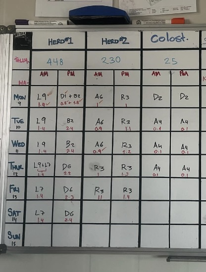
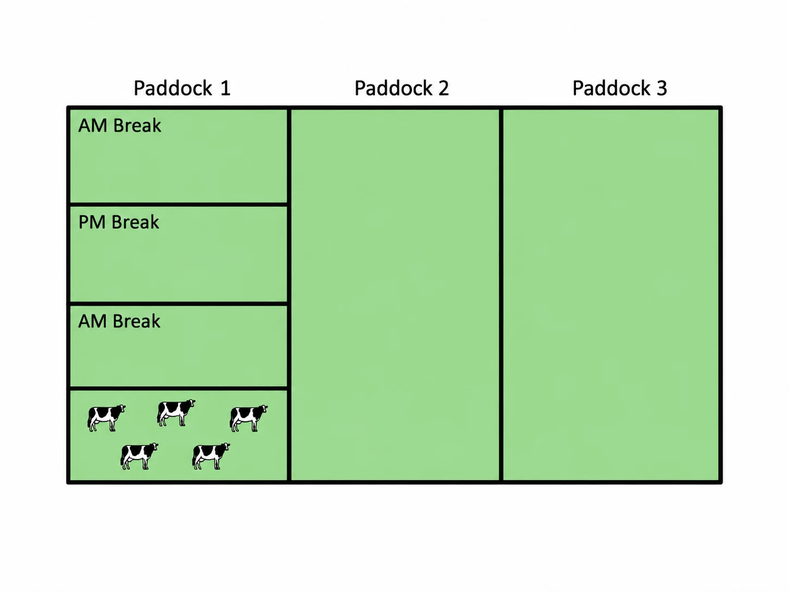
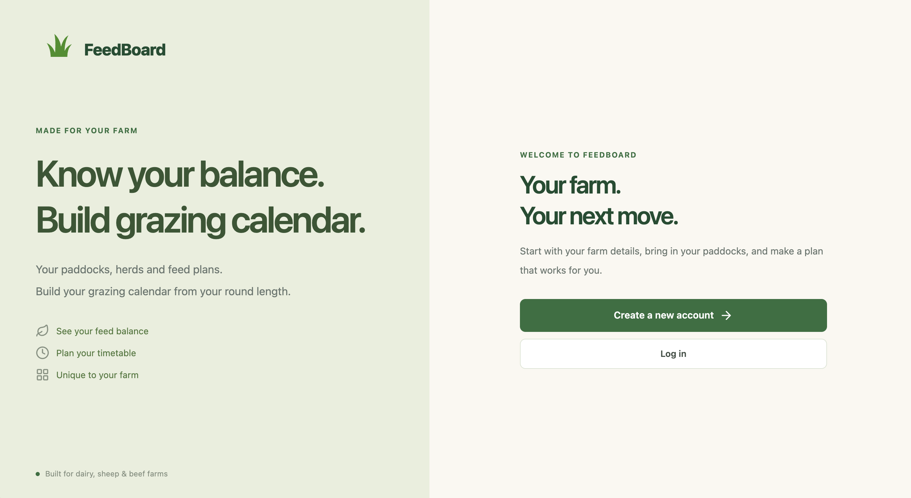
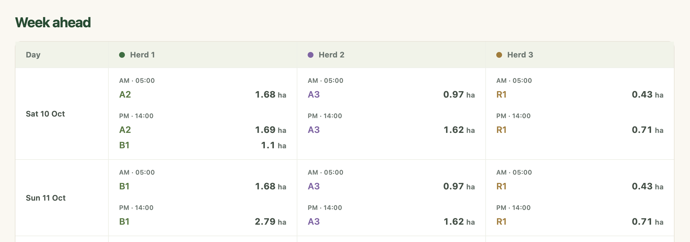
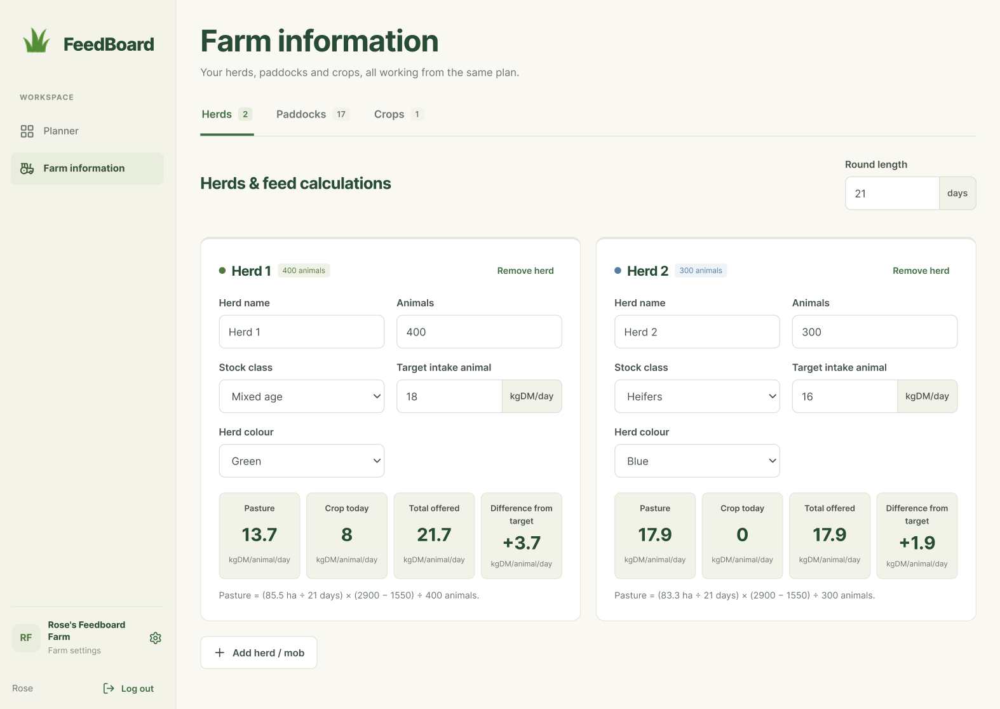
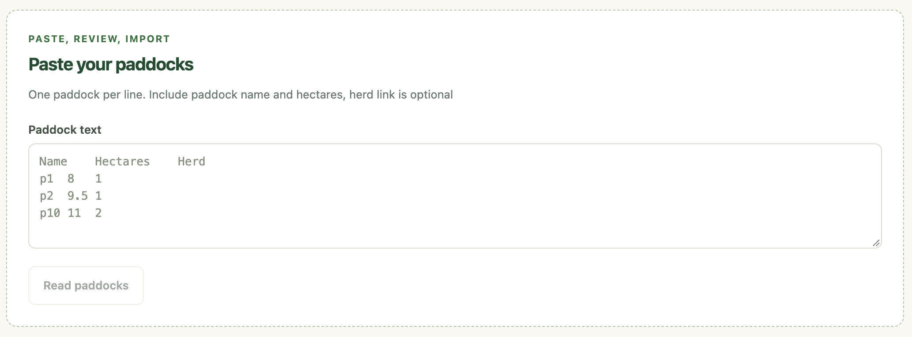

# FeedBoard

**A grazing and feed-planning website for farmers.**

FeedBoard turns a grazing plan into a digital seven-day planner. Farmers enter their herds, paddocks, grazing targets and move times, then review the planned AM/PM breaks and estimated feed available per animal.

**Project status:** The application runs locally with a React frontend, an Express API and a MySQL database.

**Repository:** [Feed-Board2 on GitHub](https://github.com/RoseMcEwan/Feed-Board2).

## The problem

Grazing plans are often kept on a whiteboard, with paddock names, herd movements and areas written by hand. Changing the herd size, paddock order or round length means parts of the plan and feed calculations must be worked out again. FeedBoard keeps a familiar grazing-plan format while recalculating from the farm's saved information.

The intended users are farm managers, staff, owners, and consultants. The project design was informed by farm experience and discussions with farmers, with an emphasis on straightforward inputs, visible calculations and a simple interface. The aim is to reduce the time spent updating grazing plans and working out feed requirements.

<details>
<summary>See the whiteboard and grazing-break example</summary>

**Typical handwritten plan**



**Grazing break:** one paddock can be grazed in smaller AM and PM sections before the animals move to another paddock.



</details>

## Features

- **Account access:** Register, sign in and sign out. Each account currently has one farm.
- **Guided farm setup:** Enter farm type, AM/PM times, round length, cover and residual targets, location, herds, paddocks and crops.
- **Paddock importer:** Paste tab-separated rows from a spreadsheet (paddock name, hectares and optional herd); preview and correct entries before adding them. Recognises herd names and numbered herds.
- **Herd and paddock management:** Maintain stock numbers, target intake, paddock areas, herd assignments and land excluded from pasture grazing (such as crops or young grass).
- **Seven-day grazing planner:** View AM/PM paddock allocations, break areas, date navigation and editable paddock order/start date.
- **Feed calculations:** Estimate grazing area, pasture kgDM per animal, crop contribution and offered feed compared with the herd's target intake.
- **Crop calculations:** Estimate feeding days remaining and the crop finish date from paddock area, yield, feeding rate, herd and start date.
- **Weather forecast:** Uses [MET Norway Locationforecast](https://api.met.no/) based on farm coordinates, with server-side caching. Weather is shown for context only. 
- **Browser drafts and autosave:** Keeps unfinished changes in browser storage, then saves valid changes through resource-specific API requests. 

**Current scope:** One farm per account. Shared staff accounts/roles, extended crop-to-herd allocation, public hosting and full farmer acceptance testing are future work.

## Screenshots

**Welcome and account access**



**Seven-day grazing plan**



<details>
<summary>See farm information and the paddock importer</summary>

**Farm information and feed calculations**



**Pasting paddock data**



</details>

## Technology

| Frontend | React, React Router, Vite, Tailwind CSS, Lucide React, date-fns |
| Backend | Node.js, Express |
| Database | MySQL, `mysql2/promise` connection pool |
| Authentication | Argon2id password hashing, `express-session`, `express-mysql-session` |
| API security | Helmet, CORS/origin checks, CSRF tokens|
| Forecast | MET Norway Locationforecast API, server-side cache |
| Testing | Node's built-in `node:test`, `node:assert/strict`, `fetch`, MySQL test database; in-memory SQLite for selected model tests |
| Design | Figma layouts and reusable React UI components |

## Project structure

```text
Feed-Board2/
├── README.md                 # This file
├── LICENSE
├── docs/images/             # Screenshots used in this README
├── ui/                       # React/Vite frontend
│   ├── public/
│   ├── src/
│   │   ├── components/      # Shared controls and feature components
│   │   ├── data/            # Default/normalised farm data
│   │   ├── hooks/           # Farm state, autosave, calculations, weather
│   │   ├── pages/           # Auth, setup, planner, farm info, settings
│   │   ├── services/        # API, draft storage, change detection
│   │   └── utils/           # Dates, paddock import, validation
│   ├── tests/
│   ├── .env.example
│   └── package.json
└── backend/                  # Express + MySQL API
    ├── calculations/        # Grazing, pasture and crop calculations
    ├── config/              # Database pool and session store
    ├── controllers/         # Request and response handling
    ├── middleware/          # Authentication, CSRF, validation, errors
    ├── models/              # MySQL reads and writes
    ├── routes/              # API endpoints
    ├── services/            # Farm mutations and weather caching
    ├── sql/001_initial.sql  # Initial MySQL schema
    ├── tests/
    ├── .env.example
    ├── .env.test.example
    ├── server.js
    └── package.json
```

A typical save flows from a React page through `useFarmData.js`, `farmChanges.js` and `api.js` to the Express routes/controllers. The farm model applies validated mutations inside a MySQL transaction and returns the confirmed saved version. Calculation previews use a separate API endpoint and **do not save the draft to MySQL**.

## Installation and local development

### Requirements

- **Node.js 22.12 or later** (with npm).
- **MySQL 8.0.16+ or 8.4** running locally.
- A MySQL client such as **MySQL Workbench**.

There are **two separate npm projects**: `backend/` and `ui/`. Install dependencies in both. The examples below assume macOS/Linux or the VS Code terminal; on Windows, create/copy the `.env` files with File Explorer if `cp` is unavailable.

### 1. Get the project

```bash
git clone https://github.com/RoseMcEwan/Feed-Board2.git
cd Feed-Board2
```

### 2. Create the MySQL database

In MySQL Workbench, connect to MySQL, choose **File → Open SQL Script**, select `backend/sql/001_initial.sql`, then run the script with the lightning-bolt **Execute** button. (You can also open the file in VS Code, copy its SQL into a Workbench query tab and execute it.)

The script creates the `feedboard` database (if missing) and these tables:

`users`, `farms`, `herds`, `paddocks`, `crops`, `queues`, `queue_items`, and `sessions`.

Create or use a MySQL account with permission to read and write the `feedboard` database. For example, a MySQL administrator can grant local access to a dedicated account (adjust the host if your MySQL connection differs):

```sql
CREATE USER IF NOT EXISTS 'feedboard_app'@'127.0.0.1'
  IDENTIFIED BY 'REPLACE_WITH_A_STRONG_PASSWORD';
GRANT SELECT, INSERT, UPDATE, DELETE ON feedboard.*
  TO 'feedboard_app'@'127.0.0.1';
```

Use the same username/password in your backend `.env` file. Do not put real credentials in source code or the README.

### 3. Configure and start the backend

Open a terminal in the project root:

```bash
cd backend
npm ci
cp .env.example .env
npm run secret
```

Copy the secret printed by `npm run secret` into `backend/.env` as `SESSION_SECRET`. Then edit the remaining settings to match your MySQL installation:

```dotenv
NODE_ENV=development
HOST=127.0.0.1
PORT=3008
CLIENT_ORIGIN=http://localhost:5173
TRUST_PROXY_HOPS=0

DB_HOST=127.0.0.1
DB_PORT=3306
DB_USER=feedboard_app
DB_PASSWORD=REPLACE_WITH_YOUR_DATABASE_PASSWORD
DB_NAME=feedboard
DB_SSL_CA=

SESSION_SECRET=PASTE_THE_SECRET_FROM_NPM_RUN_SECRET
WEATHER_USER_AGENT=FeedBoard/1.0 your-email@example.com
```

Replace all placeholder values; the weather user agent should contain a real contact method appropriate for requests to MET Norway. `DB_SSL_CA` is optional and is used when your database requires a custom trusted CA certificate.

Start the backend:

```bash
npm run dev
```

It listens on **http://127.0.0.1:3008** by default. You can check database/API health at **http://127.0.0.1:3008/api/health**. If the session secret is too short or database settings are missing, the backend intentionally refuses to start.

### 4. Configure and start the frontend

Open a **second terminal**, leaving the backend running:

```bash
cd ui
npm ci
cp .env.example .env
npm run dev
```

The frontend is available at **http://localhost:5173**. Vite proxies requests beginning with `/api` to the Express backend on port **3008** (configured in `ui/vite.config.js`).

To enable the weather strip, set `VITE_WEATHER_ENABLED=true` in `ui/.env` **and** set `WEATHER_USER_AGENT` in `backend/.env`. To turn weather off, use `VITE_WEATHER_ENABLED=false` and restart Vite after editing the file.

### 5. Try the website

1. Open `http://localhost:5173`.
2. Register an account and complete the five-step farm setup.
3. Enter your herds and paste paddocks as spreadsheet rows: **name**, **hectares**, optionally **herd**.
4. Check or change herd allocation, crop information and grazing settings.
5. Open the grazing planner, set paddock order and review the AM/PM breaks.
6. Return to Farm Information to check pasture, crop and feed-balance calculations. Changes are drafted locally and valid edits are saved to MySQL.

## Testing

Tests are provided for frontend utilities, backend calculations/farm mutations and HTTP API workflows.

**Frontend unit tests** — from `ui/`:

```bash
npm test
```

**Backend unit and persistence tests** — from `backend/`:

```bash
npm test
```

**API integration tests**

The API tests use a separate MySQL test database and a `.env.test` configuration file. Always use `feedboard_test` rather than your normal `feedboard` database.

If you have already completed the setup, skip to **Running the tests**.

**First-time setup**

Complete these steps once when setting up the project on a new computer.

1. In MySQL Workbench, use an administrator connection to create the test database:

   ```sql
   CREATE DATABASE IF NOT EXISTS feedboard_test
     CHARACTER SET utf8mb4 COLLATE utf8mb4_unicode_ci;
   ```

2. Create a dedicated test account and give it access to `feedboard_test`. Replace the password placeholder before running:

   ```sql
   CREATE USER IF NOT EXISTS 'feedboard_test_app'@'127.0.0.1'
     IDENTIFIED BY 'REPLACE_WITH_A_DIFFERENT_TEST_PASSWORD';

   GRANT SELECT, INSERT, UPDATE, DELETE, CREATE, REFERENCES
     ON feedboard_test.*
     TO 'feedboard_test_app'@'127.0.0.1';
   ```

3. Copy `backend/.env.test.example` to `backend/.env.test`. Enter the test account's credentials and a session secret generated with `npm run secret` from `backend/`. Check these settings:

   ```dotenv
   NODE_ENV=test
   DB_HOST=127.0.0.1
   DB_USER=feedboard_test_app
   DB_PASSWORD=YOUR_TEST_DATABASE_PASSWORD
   DB_NAME=feedboard_test
   SESSION_SECRET=YOUR_GENERATED_SESSION_SECRET
   ```

   Keep `.env.test` private and excluded from Git.

**Running the tests**

From the `backend/` folder, run:

```bash
npm run test:api
```

**Test results recorded in October 2026:** 4 frontend unit tests, 23 backend tests and 13 API test entries passing (the 13 includes the parent test entry). 

Other useful commands:

| Folder | Command | Purpose |
| --- | --- | --- |
| `ui/` | `npm run lint` | Check frontend lint rules |
| `ui/` | `npm run build` | Generate a production frontend build in `ui/dist` |
| `ui/` | `npm run preview` | Preview the built frontend locally |
| `backend/` | `npm start` | Start the backend without file watching |
| `backend/` | `npm run secret` | Generate a new session secret |

## API and CRUD overview

The API uses authenticated sessions. Changing requests are protected by CSRF tokens. **Farm record IDs and versions** are checked before mutations so an outdated browser tab cannot silently overwrite a newer farm.

| Operation | Method | Route | Example use |
| --- | --- | --- | --- |
| Health | `GET` | `/api/health` | Check API/database availability |
| Account/session | `GET`, `POST` | `/api/auth/session`, `/api/auth/register`, `/api/auth/login`, `/api/auth/logout` | Sign in and out |
| Farm | `GET`, `POST`, `PATCH`, `DELETE` | `/api/farm` | Read, create, edit or delete an entire farm |
| Herds | `POST`, `PATCH`, `DELETE` | `/api/farm/herds[/:herdId]` | Add, edit or remove a herd |
| Paddocks | `POST`, `PATCH`, `DELETE` | `/api/farm/paddocks[/:paddockId]` | Manage paddocks |
| Crops | `POST`, `PATCH`, `DELETE` | `/api/farm/crops[/:cropId]` | Manage crop records |
| Planner queues | `PUT`, `DELETE` | `/api/farm/queues/:herdId` | Replace/remove a herd's paddock order |
| Calculations | `POST` | `/api/farm/calculate` | Preview values from a draft without saving |
| Weather | `GET` | `/api/weather?lat=...&lon=...` | Retrieve cached forecast |

For readability, `[...]` above denotes optional route variants shown together; Express routes are defined separately in `backend/routes/farmRoute.js`. `DELETE /api/farm` exists in the API but there is currently **no Delete Farm button** in the UI.

## Data model

MySQL has a one-farm-per-account `users → farms` relationship. A farm has `herds` and `paddocks`; a crop belongs to a paddock and a receiving herd. Saved planner `queues` link to herds, and `queue_items` specify the paddock order. `sessions` is used for login storage. Foreign keys and database checks protect linked data.

## Security and data handling

- Passwords are hashed with **Argon2id** before storage (`backend/controllers/authController.js`).
- Login sessions use **`express-session` + `express-mysql-session`**, with HttpOnly and SameSite cookies; Secure cookies are enabled in production. An **eight-hour absolute session limit** is enforced (not an inactivity timeout).
- **Helmet** adds HTTP security headers, including a Content Security Policy.
- **CSRF tokens** are randomly generated using Node's `crypto` module and checked with `timingSafeEqual()` on protected writes.
- **`express-rate-limit`** provides separate controls for account attempts, email attempts, weather and calculations.
- **CORS and origin checks** restrict approved frontend origins; these are in addition to user authentication and record-ownership checks.
- **MySQL transactions, unique/foreign keys and farm-version checks** help prevent incomplete or conflicting saves.
- Environment files contain passwords/secrets 

**Before a public launch:** configure HTTPS and hosting, protect secrets and backups, add monitoring, test permissions and browser behaviour, and review the handling of locally stored drafts. Browser drafts use `localStorage` and are **not encrypted** by the application.

## Next steps

- Test the website with farmers on desktop and mobile, and record their feedback.
- Review production security, backups, monitoring and recovery processes.
- Prepare Docker packaging, AWS hosting, production MySQL and an HTTPS domain.
- Consider multiple users per farm and more flexible crop-to-herd allocation in a later version.

## Licence

This project is licensed under the MIT Licence. 
